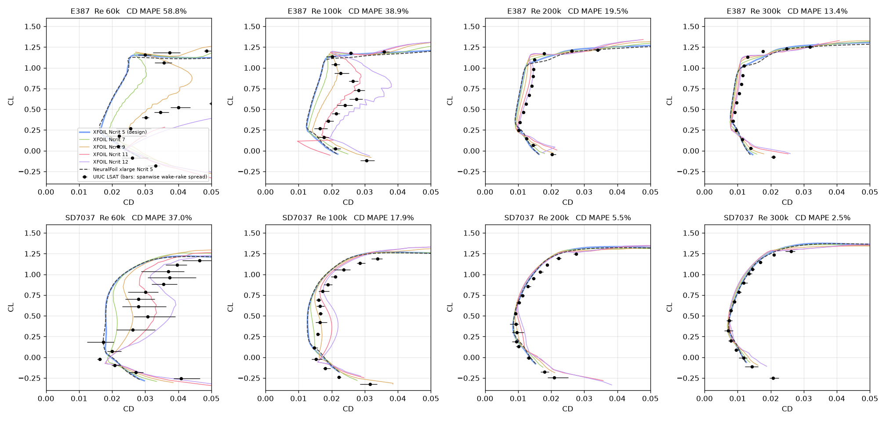

# StratoGlide

Balloon-launched stratospheric ISR glider, taken from mission requirements to a build-ready package. **Design complete, build pending; no flight claims.** Every number below is read from `results/numbers.json` (values hash `e31dfd957ae22940`), produced by the scripts in this repo.

## Run

```bash
make all        # tools, every phase P1-P9 into a fresh run directory, numbers.json, report, site, verify.py
make verify     # just the numbered checks 0-20
```

## Results

| Quantity | Value | Key |
|---|---|---|
| MTOW | 3.760 kg | `p3.mtow_kg` |
| Span / area / AR | 1.618 m / 0.436 m^2 / 6.0 | `p3.span_m` |
| XFOIL vs UIUC CD error, Re 100k-200k (worst / best) | 38.9% / 5.5% | `derived.cd_mape_re100k_200k_worst` |
| Static margin SL / 20 km | 11.49% / 11.49% MAC | `p4.sm_pct_sl` |
| Release MC runs / autopilot recovery | 500 / 100.0% | `p5.recovery_rate_autopilot` |
| Peak Mach P99 / altitude lost P95 | 0.417 / 1,065 m | `p5.mach_p99` |
| Variable pitch gain (same blade) | 1.04 eta points | `p6.vp_gain_eta_points_max` |
| Loiter endurance at 19 km | 35.5 min | `p7.endurance_min_19km` |
| BOM (airframe, all ESTIMATE) | INR 70,600 | `p8.bom_total_inr` |



## What it is not

Not flown, not built, no CFD or tunnel test of the full aircraft. Failed pre-registered bars are listed in `HONEST_LOG.md` and in the report, not loosened.

## Repo map

`config/` frozen requirements and bars, inputs; `src/stratoglide/` atmosphere, airfoil, sizing, stability, release, prop, perf, build, report; `verify.py` 20 checks; `outputs/` figures, geometry, BOM, test cards, report; `site/` static dashboard; `results/numbers.json` every number with provenance.